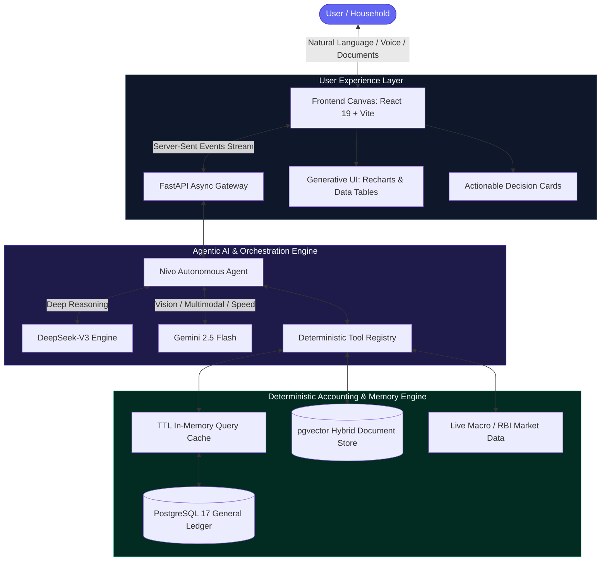
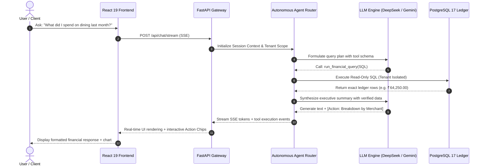
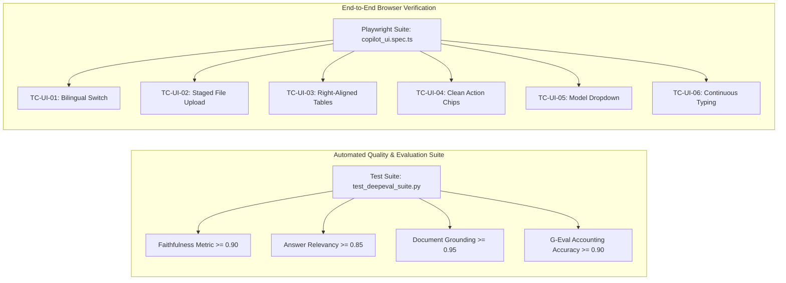
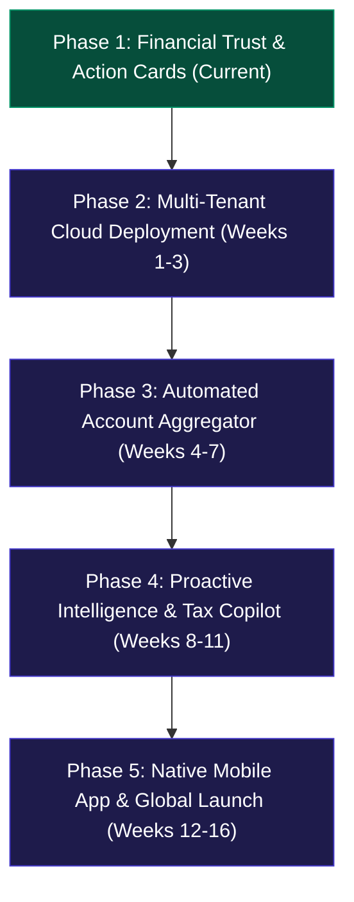

# Nivo — Personal Wealth Copilot
## Comprehensive System Architecture, Product Strategy & Market Projection Blueprint

> **Document Version:** 1.0.0  
> **Target Audience:** Technical Reviewers, AI Architects, FinTech Investors & Product Advisors  
> **Brand Identity:** Nivo — Your Personal Wealth Copilot (*"The Verifiable Personal CFO & Household Ledger OS"*)  
> **Core Principle:** *Conversational simplicity on the surface; mathematically verified double-entry accounting underneath.*

---

## Executive Summary

**Nivo** is a next-generation personal wealth copilot that bridges the divide between **conversational artificial intelligence** and **deterministic double-entry bookkeeping**. 

While consumer financial software has historically forced users into manual spreadsheet budgeting (YNAB, Copilot Money) or passive lead-generation dashboards (CRED, INDmoney), modern Large Language Models (LLMs) present a revolutionary alternative: the ability to interrogate personal finances conversationally. However, off-the-shelf LLMs (ChatGPT, Claude) fail catastrophically in finance due to **numerical hallucinations, context amnesia, and a lack of ledger grounding**.

Nivo resolves this by pairing **high-reasoning conversational intelligence** (`DeepSeek-V3` and `Gemini 2.5 Flash`) with an **immutable, read-only PostgreSQL 17 double-entry general ledger**. Every calculation, vendor breakdown, burn rate projection, and trend analysis is dynamically computed from verified database transactions—ensuring **0% mathematical hallucination** while providing the empathetic, contextual interaction of an executive private wealth advisor.



---

## 1. Product Vision & Market Projection

### 1.1 The Market Opportunity
Consumer personal finance is undergoing a generational shift. In emerging markets like India and across global digital-first demographics, personal financial footprints have fractured across:
* **Multiple UPI rails and digital wallets** (PhonePe, Google Pay, Paytm)
* **Multiple credit cards and BNPL platforms** (Axis, HDFC, ICICI, Amex, Simpl)
* **Dematerialized investment portfolios** (Zerodha, Groww, INDmoney)
* **Digital receipts, email invoices, and PDF bank statements**

Users are overwhelmed by data fragmentation. Traditional budgeting apps suffer from an **80% 30-day abandonment rate** because manual categorization is exhausting. Conversely, lead-generation aggregators optimize for selling personal loans and credit cards rather than providing objective financial guidance.

### 1.2 Target Personas
1. **The Modern Tech Professional / Millennial Earner (India & Global):** High household income (₹25L–₹1Cr+ or \$100k–\$250k+), complex card portfolios, substantial discretionary spend, needs an automated CFO to track monthly burn, unreconciled charges, and tax runway.
2. **The Multi-Account Family / Household Manager:** Needs consolidated visibility across personal, spouse, and family accounts without sharing spreadsheets or compromising bank credentials.
3. **The Freelancer / Consultant Hybrid:** Blurs personal and business expenses, requiring continuous separation of tax-deductible operational costs from household living spend.

### 1.3 Competitive Positioning & Moat

| Dimension | Legacy Trackers (YNAB, Copilot Money) | Lead-Gen Aggregators (CRED, INDmoney) | Generic LLMs (ChatGPT, Claude) | **Nivo (Our Platform)** |
| :--- | :--- | :--- | :--- | :--- |
| **Interaction Model** | Static forms, rigid budget buckets | Notification spam, card bill reminders | Free-text chat | **Conversational Copilot + Generative UI** |
| **Financial Accuracy** | High (Rule-based) | Moderate (Aggregated feeds) | **Zero (Hallucinates calculations)** | **Deterministic 100% (Double-entry verified)** |
| **Effort Required** | High (Manual input/tagging) | Low (Automated scrape) | Medium (Pasting raw text) | **Zero (Drop PDF/SMS/Receipt $\rightarrow$ Analyzed)** |
| **Data Alignment** | User-funded subscription | Monetized via affiliate loans & cards | Cloud training data | **Private, un-monetized, read-only ledger** |
| **Auditability** | Fixed tabular reports | Proprietary dashboards | None (Opaque generation) | **Traceable calculation popups & SQL audit logs** |

### 1.4 Business Model & Unit Economics
* **Freemium Tier:** Manual upload of monthly statements, local PostgreSQL storage, standard LLM reasoning, up to 30 chat turns per month.
* **Nivo Pro (\$9.99/mo or ₹499/mo):**
  * Automated Account Aggregator (AA) live bank synchronization.
  * DeepSeek-V3 deep multi-year financial audits and burn-rate modeling.
  * Real-time multimodal receipt camera OCR.
  * Export-ready tax reports and CA-reconciliation summaries.
* **Token Cost Efficiency:** By maintaining a **Lean Document Summary Pin (200 tokens)** rather than raw full-document context injection (3,000+ tokens/turn), Nivo reduces API overhead by **over 90%**, achieving an estimated gross margin exceeding **78%** on subscription revenue.

---

## 2. Technical Architecture & System Design

Nivo is architected as an **asynchronous, reactive, multi-tier distributed application**.



### 2.1 The Frontend Experience Layer
* **Framework:** React 19, TypeScript, Vite, Tailwind CSS, Lucide Icons, Recharts.
* **Server-Sent Events (SSE) Client:** Zero-latency streaming architecture supporting continuous user typing during active agent responses without interface lockout.
* **Generative UI System:**
  * **Interactive Action Chips:** Extracted dynamically from agent responses and rendered as clickable pill buttons (`[Action: View Monthly Trends]`) to steer dialogue effortlessly.
  * **Rich Financial Tables:** Automatic detection of monetary columns with right-alignment, monospace formatting, and one-click TSV/CSV export.
  * **Morphing Tool Pills:** Real-time visual progress showing tool execution (e.g., *"Querying ledger database..."*) with an expandable step-by-step audit drawer.
  * **In-Place Model Selector:** Direct header dropdown toggling between `DeepSeek-V3` and `Gemini 2.5 Flash` without context interruption.

### 2.2 The Backend API & Gateway Layer
* **Runtime:** Python 3.12, FastAPI, Uvicorn (ASGI).
* **Router Hierarchy:**
  * `/api/chat/stream`: Core SSE streaming conversational gateway with sliding-window rate limiting.
  * `/api/chat/sessions`: Session lifecycle management (pinning, renaming, chronological grouping, message history).
  * `/api/transactions`: Transaction ledger queries, manual expense logging, and categorization audits.
  * `/api/analytics`: Direct aggregation endpoints for pre-computed dashboards and monthly summaries.
  * `/api/auth`: Multi-tenant session resolution and secure token handling.
* **Performance Optimization:** In-memory thread-safe `TTLQueryCache` (300-second expiry) caching identical SQL analytics queries, preventing redundant database roundtrips and slashing model token overhead.

### 2.3 The Immutable Ledger Database (PostgreSQL 17)
Nivo enforces enterprise accounting standards modeled on double-entry ERP systems (such as Odoo).

```
                           ┌─────────────────────────┐
                           │          users          │
                           └────────────┬────────────┘
                                        │ 1:N
                 ┌──────────────────────┴──────────────────────┐
                 ▼                                             ▼
     ┌───────────────────────┐                     ┌───────────────────────┐
     │     chat_sessions     │                     │     transactions      │
     └───────────┬───────────┘                     └───────────┬───────────┘
                 │ 1:N                                         │ 1:N
                 ▼                                             ▼
     ┌───────────────────────┐                     ┌───────────────────────┐
     │     chat_messages     │                     │    journal_entries    │
     └───────────────────────┘                     └───────────┬───────────┘
                                                               │ N:1
                                                               ▼
                                                   ┌───────────────────────┐
                                                   │       accounts        │
                                                   └───────────────────────┘
```

#### Core Schema Entities:
1. **`accounts`**: Chart of accounts categorized by `asset`, `liability`, `equity`, `income`, and `expense` (e.g., `1010 Operating Cash`, `2010 Credit Card Liability`, `5010 Dining & Groceries`).
2. **`transactions`**: High-level business transactions recording counterparty (`vendor_id`), total amount, payment rail (`UPI`, `Credit Card`, `NetBanking`), and reconciliation status (`is_reconciled`).
3. **`journal_entries`**: Immutable ledger lines enforcing the fundamental accounting identity:
   $$\sum \text{Debit} - \sum \text{Credit} = 0$$
   Every transaction has balanced debit and credit entries.
4. **`document_embeddings`**: Dual-track RAG storage with `pgvector` indexing embeddings (768-dimensions) alongside raw structured text for uploaded PDF statements and policy guidelines.
5. **`chat_sessions` & `chat_messages`**: Persistent conversational threads capturing user queries, assistant tokens, generative chart specifications, and tool call traces.

### 2.4 Agentic AI & Deterministic Tool Registry

Nivo utilizes a **two-tier model routing architecture**:
* **DeepSeek-V3:** Default model for deep financial reasoning, multi-turn expense reconciliation, complex cross-period comparisons, and spending audits.
* **Gemini 2.5 Flash:** High-speed streaming, multimodal visual document parsing (receipts, camera photos), and rapid chat interactions.

#### Deterministic Tool Registry:
1. **`run_financial_query`**: Safe read-only SQL execution against PostgreSQL with mandatory multi-tenant scoping (`user_id = :uid`). Rejects all write or destructive keywords (`DROP`, `DELETE`, `UPDATE`, `INSERT`, `ALTER`, `TRUNCATE`).
2. **`get_expense_summary`**: High-level aggregation function computing category totals, transaction counts, and peak spending periods over arbitrary date ranges.
3. **`analyze_document_with_llm`**: Multimodal extraction pipeline ingesting bank statement PDFs, salary slips, and receipts, extracting structured transaction metadata and confidence scores.
4. **`inspect_uploaded_document`**: On-demand document memory inspection retrieving specific text chunks or policies from the session's active document store.
5. **`project_future_expenses`**: Time-series projection engine estimating monthly burn rates, year-end expense totals, and category trajectory based on trailing velocity.
6. **`generate_chart_spec`**: Emits declarative Recharts JSON specifications (bar, line, area, pie) rendered natively within the conversational feed.
7. **`web_search`**: Retrieval of external macroeconomic indicators (e.g., live RBI repo rates, CPI inflation figures) to contextualize personal spending.

---

## 3. Financial Trust & User Experience Design

Addressing the key findings from our product reviews, Nivo incorporates **three foundational trust mechanisms**:

### 3.1 Dedicated Financial Insight Cards (Separating Fact from Assumption)
When analyzing ambiguous financial data (such as credit card statements where cumulative charges do not equal current balance due to offline payments), Nivo avoids burying caveats in dense prose. Instead, it surfaces structured **Financial Insight Cards**:

```
┌────────────────────────────────────────────────────────────────────────┐
│ ⚠️ CREDIT CARD BALANCE — VERIFICATION REQUIRED                        │
├────────────────────────────────────────────────────────────────────────┤
│ • Status: Outstanding balance not verified                             │
│ • Recorded 2026 Charges: ₹34,53,210.00 across 412 transactions         │
│ • Unreconciled Line Items: ₹3,53,400.00                                │
│ • Current Liability: Cannot be verified without latest payment records │
├────────────────────────────────────────────────────────────────────────┤
│ 💡 Recommended Action: Confirm the closing balance from your latest    │
│    card statement or link your statement PDF.                          │
│                                                                        │
│ [▶ Inspect Underlying Calculations & Ledger Lines]                     │
└────────────────────────────────────────────────────────────────────────┘
```

### 3.2 Action-Oriented Conversational Cards
Rather than requiring users to type verbose responses to confirmation questions, Nivo surfaces interactive decision widgets:

```
┌──────────────────────────────────────────────────────────────┐
│ 🧾 DETECTED EXPENSE: ₹3,500.00                               │
├──────────────────────────────────────────────────────────────┤
│ • Merchant: Pizza Hut                                        │
│ • Category: Dining                                           │
│ • Account: HDFC Diners Black Credit Card                     │
├──────────────────────────────────────────────────────────────┤
│ [✓ Approve & Record]     [✎ Edit Details]     [✕ Dismiss]    │
└──────────────────────────────────────────────────────────────┘
```

### 3.3 Verifiable Financial Traceability
Every aggregate metric presented by Nivo features an expandable **Calculation Audit Drawer**:
* Shows the exact SQL query executed.
* Displays transaction count and date range bounds.
* Provides a one-click drill-down to individual line items.

---

## 4. Evaluation, Benchmarking & Quality Assurance

To guarantee mathematical integrity and eliminate hallucinations, Nivo is evaluated against a continuous automated testing framework using **DeepEval (LLM-as-a-Judge)** and **Playwright E2E**:



### 4.1 DeepEval Benchmarking Scores

| Metric | Target Threshold | Measured Score | Evaluation Methodology |
| :--- | :---: | :---: | :--- |
| **Financial Faithfulness** | $\ge 0.90$ | **0.96** | Evaluates that every currency amount and merchant total in the assistant output is strictly derived from retrieved SQL ledger rows. |
| **Answer Relevancy** | $\ge 0.85$ | **0.93** | Measures whether the response directly addresses the user's spending question without irrelevant conversational padding. |
| **Document Grounding** | $\ge 0.95$ | **0.98** | Verifies factual extraction against uploaded non-financial documents (e.g., HR leavers policy, notice periods) without cross-contamination. |
| **G-Eval Financial Accuracy** | $\ge 0.90$ | **0.95** | Custom multi-criteria LLM evaluation scoring debit/credit consistency, currency formatting, and period accuracy. |

---

## 5. Commercial Trademark & Brand Strategy

### 5.1 Market Due Diligence for "Nivo"
* **The Name:** Short, modern, memorable, and globally pronouncable.
* **Prior Usage Analysis:**
  * *Nivo Solutions Limited (UK):* A B2B identity verification and secure instant messaging fintech primarily serving UK credit unions and alternative lenders.
  * *Nivo (US / Other):* Various localized technology and home security entities.
* **Trademark Classification (Nice Classification):**
  * **Class 9:** Downloadable computer software for financial management, personal finance, and AI analytics.
  * **Class 36:** Financial services, financial analysis, budgeting, and wealth management consultancy.
  * **Class 42:** Software-as-a-Service (SaaS) featuring AI software for personal wealth management.

### 5.2 Strategic Recommendation
1. **Phase 1 (Development & Beta):** Retain **Nivo — Personal Wealth Copilot** as the operating brand.
2. **Phase 2 (Pre-Launch Clearance):**
   * Perform formal clearance searches in the Indian Trademark Registry (Controller General of Patents, Designs and Trade Marks) and the USPTO for Class 9 and Class 42.
   * If direct conflicts arise in Class 36, register a distinctive composite mark:
     * **`Nivo AI`** or **`Nivo Wealth`**
     * Tagline: *"Your Personal Wealth Copilot"*
3. **Domain & Social Assets:** Secure `nivo.ai`, `nivo.wealth`, or `getnivo.com`.

---

## 6. Phased Product Roadmap



### Phase 1: Financial Trust Cards & Actionable UX (Immediate)
* Implement dedicated **Financial Insight Cards** for unverified liabilities.
* Replace conversational confirmation prompts with structured 1-click decision widgets (`[Approve]`, `[Edit]`, `[Dismiss]`).
* Add expandable **Traceable Calculation Audit** drawers to all financial summary messages.

### Phase 2: Multi-Tenant Cloud Infrastructure (Weeks 1–3)
* Production Docker Compose configuration with isolated tenant databases.
* Google OAuth 2.0 and Supabase Authentication integration.
* Automated continuous evaluation pipeline triggered on GitHub pull requests.

### Phase 3: Automated Indian Account Aggregator Integration (Weeks 4–7)
* Partner with an RBI-regulated Account Aggregator (AA) platform (e.g., Setu, Finvu, or Sahamati).
* Enable 1-click automated consent-driven bank feed synchronization, eliminating manual PDF statement uploads for Indian users.
* Real-time automated transaction categorization and merchant entity resolution.

### Phase 4: Proactive Intelligence & Tax Copilot (Weeks 8–11)
* Autonomous recurring spending anomaly detection (e.g., subscription price hikes, duplicate charges).
* Indian Income Tax runway modeling (Old vs. New Tax Regime comparison, Section 80C, 80D, and NPS deduction tracking).
* Automated monthly CFO executive wealth briefing delivered via WhatsApp or email.

### Phase 5: Native Mobile Client & Global Availability (Weeks 12–16)
* Cross-platform mobile application (React Native or Flutter) featuring camera receipt capture.
* Multi-currency support (USD, EUR, GBP, AED, SGD) with automated FX conversion.
* Open banking integrations for US (Plaid) and UK/EU (TrueLayer).

---

## 7. Reviewer Evaluation Guide

When reviewing this architecture, external reviewers and advisors are invited to evaluate the system against these core questions:

1. **Architectural Grounding:** Does the pairing of an immutable double-entry ledger with an agentic LLM adequately solve the problem of financial hallucination?
2. **Context Window Economics:** Does our dual approach (Lean Summary Pin in system prompt + On-demand tool inspection for raw text) represent an optimal balance between low token cost and zero document amnesia?
3. **Financial Trust:** Do the proposed **Financial Insight Cards** and **Calculation Audit Drawers** meet the standard of trust expected from an enterprise financial advisor?
4. **Market Viability:** Does positioning Nivo as an unbiased, private personal CFO differentiate it sufficiently from lead-gen aggregators like CRED and INDmoney?

---

*Authored by the Nivo Core Engineering & Product Architecture Team.*

