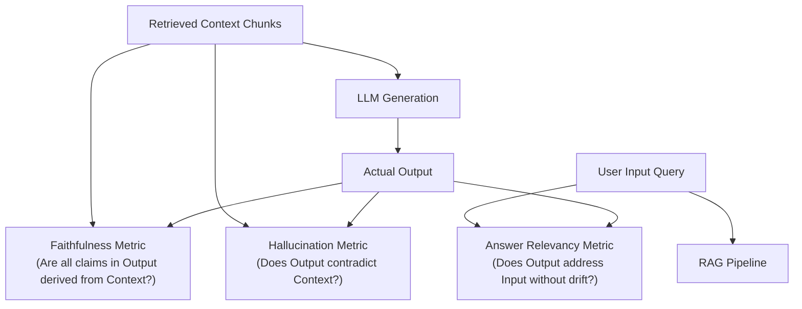

# 🤖 AI / LLM / RAG EVALUATION & OBSERVABILITY: DEEPEVAL & LANGFUSE
**Target**: Complete Guide to AI Quality Engineering, RAG Metrics, Hallucination Detection & Observability  
**Candidate**: Lokender Singh (8+ yrs Exp)  
*Note: This is an exhaustive, self-contained reference and conceptual guide. It explains everything from initial installation to metric algorithms, custom judges, golden datasets, and Langfuse tracing.*

---

## 1. Installation & Environment Setup from Scratch

### 1. Installing Core AI Quality Libraries
Run inside your Python virtual environment:
```bash
pip install deepeval langfuse httpx pytest-asyncio
```
- **`deepeval`**: The open-source evaluation framework for LLMs and RAG systems (runs via Pytest).
- **`langfuse`**: Open-source LLM observability, tracing, and metric tracking platform.
- **`httpx`**: Asynchronous HTTP client for hitting streaming LLM chat endpoints (`/api/chat/stream`).

### 2. Verifying Installation
```bash
deepeval --version
```

---

## 2. Core Theory: Why Testing AI Applications is Radically Different

### The Fundamental Paradigm Shift
In traditional software quality engineering, inputs and outputs are **deterministic**:
```python
# Traditional Testing: Exact Deterministic Equality
assert calculate_copay(200.0, 0.20) == 40.0
```
In modern Generative AI / RAG applications:
- The same prompt submitted twice can yield two completely different natural language sentences with the exact same underlying meaning.
- Asserting `assert "The copay is $40" in response` is brittle and fails if the model says: *"Under your plan, you are responsible for an out-of-pocket copay of $40."*
- **The SDET Solution**: You test along **Evaluative Dimensions** (Faithfulness, Relevancy, Hallucination, Groundedness) using evaluated LLM-as-a-judge rubrics and deterministic NLP checks.

### Data Validation vs. Metric Evaluation (Your Key Interview Differentiator)
- **Data Validation**: Asserting that a tool call extracted the correct integer parameter or that an API returned status 200.
- **Metric Evaluation**: Measuring whether the LLM's natural language response **hallucinated** an unverified benefit, whether it was strictly **faithful** to the retrieved context, and whether it directly **answered** the user's intent.

### The RAG Lifecycle & Its Two Core Failure Modes
A Retrieval-Augmented Generation (RAG) system operates in two phases:
```
[ User Query ] ──> [ 1. Retrieval Engine (Vector DB / SQL) ] ──> [ Retrieved Context Chunks ]
                                                                             │
[ Final Answer ] <── [ 2. Generation Engine (LLM Synthesizer) ] <───────────┘
```

RAG systems fail in two distinct ways:
1. **Retrieval Failure**: The retrieval engine fetches irrelevant documents (noise) or fails to fetch the critical document needed to answer the question.
2. **Generation Failure**: The retrieval engine fetched the correct document, but the LLM hallucinated, invented numbers, contradicted the text, or ignored the context.

---

## 3. DeepEval Framework Architecture

DeepEval is built on top of **Pytest**. When you write a DeepEval test, you execute it using standard `pytest`:
```bash
pytest backend/tests/evals/test_deepeval_suite.py -v
```

### The Core Entity: `LLMTestCase`
Every evaluation in DeepEval begins with an `LLMTestCase`:
```python
from deepeval.test_case import LLMTestCase

test_case = LLMTestCase(
    input="What is the copay for an in-network specialist visit under Policy POL-100?",
    actual_output="Under Policy POL-100, the in-network specialist copay is $40.00.",
    retrieval_context=[
        "Policy POL-100 Schedule of Benefits: Primary care visit copay is $20.00. In-network specialist copay is $40.00.",
        "Out-of-network specialist visits require prior authorization and 30% coinsurance."
    ],
    expected_output="The in-network specialist copay is $40.00."
)
```

| `LLMTestCase` Parameter | What It Represents |
| :--- | :--- |
| **`input`** | The raw user query or prompt sent to the AI application. |
| **`actual_output`** | The natural language text generated by your LLM / API. |
| **`retrieval_context`** | The list of text chunks retrieved from vector search or SQL queries and fed into the prompt. |
| **`expected_output`** | The ideal ground-truth response from your Golden Dataset. |
| **`context`** | Optional ideal reference documents (used for retrieval evaluation). |
| **`tools_called`** | List of tool invocations made by an autonomous agent. |

---

## 4. The Core Evaluation Metrics (Formulas & Mechanics)



### 1. Faithfulness (`FaithfulnessMetric`) - Measuring Groundedness
- **What it Evaluates**: Is every factual statement in the generated response derived strictly from the retrieved context?
- **How It Works Under the Hood**:
  1. **Claim Extraction**: The evaluator breaks the `actual_output` into a list of atomic factual statements.
  2. **Verification**: For each claim, it verifies whether the claim can be logically deduced from the `retrieval_context`.
  3. **Scoring Formula**:
     $$\text{Faithfulness Score} = \frac{\text{Number of Truthful Claims Supported by Context}}{\text{Total Number of Claims Made in Output}}$$
- **Threshold**: Set to $\ge 0.85$ (or $1.0$ for critical healthcare/financial assertions).
- **Catches**: Hallucinations where the LLM invents policies, prices, or clinical codes not present in the database.

### 2. Answer Relevancy (`AnswerRelevancyMetric`) - Measuring Directness
- **What it Evaluates**: Did the LLM answer the user's specific prompt, or did it produce irrelevant, generic, or off-topic filler?
- **How It Works Under the Hood**:
  1. The evaluator reads the `actual_output` and generates a set of synthetic questions that this output would naturally answer.
  2. It computes the semantic embedding cosine similarity between the synthetic questions and the original `input`.
  3. It identifies non-committal filler or off-topic sentences and applies a penalty.
- **Threshold**: Set to $\ge 0.80$.

### 3. Hallucination (`HallucinationMetric`) - Measuring Contradictions
- **What it Evaluates**: Does the generated response directly contradict or fabricate facts outside the provided context?
- **Scoring**: $0.0$ indicates zero hallucinations (perfect); $1.0$ indicates complete hallucination.
- **Threshold**: Must be $\le 0.15$ or $0.00$.

### 4. Retrieval Metrics: Contextual Precision & Contextual Recall
To evaluate the **Retrieval Engine** (Vector DB / Embeddings) independently from the LLM generator:
- **`ContextualPrecisionMetric`**: Evaluates whether the most relevant context chunks were ranked at the **top** of the retrieval list (higher precision at $K$).
- **`ContextualRecallMetric`**: Measures whether the retrieved context chunks contained all the facts needed to match the `expected_output`.

### 5. G-Eval (`GEval` - Custom Criteria Rubrics)
When pre-built metrics don't cover a custom business requirement, G-Eval allows you to define custom evaluation criteria using natural language:
```python
from deepeval.metrics import GEval
from deepeval.test_case import LLMTestCaseParams

emergency_disclaimer_metric = GEval(
    name="Emergency Disclaimer Enforcement",
    criteria="Determine whether the response contains a clear disclaimer directing the user to call 911 or visit an emergency room if the query mentions acute chest pain.",
    evaluation_params=[LLMTestCaseParams.INPUT, LLMTestCaseParams.ACTUAL_OUTPUT],
    threshold=1.0
)
```

---

## 5. Implementing a Zero-Cost Custom LLM Judge (`DeepEvalBaseLLM`)

You do **not** need expensive OpenAI API keys to run DeepEval. You can implement `DeepEvalBaseLLM` to use DeepSeek, Gemini Flash, or local Ollama instances:

```python
from deepeval.models import DeepEvalBaseLLM
import httpx
import os

class CustomLLMJudge(DeepEvalBaseLLM):
    def __init__(self, provider="deepseek"):
        self.provider = provider

    def load_model(self):
        return self

    def generate(self, prompt: str) -> str:
        # Synchronous API call to DeepSeek / Gemini / local Ollama
        with httpx.Client(timeout=60.0) as client:
            resp = client.post(
                "https://api.deepseek.com/v1/chat/completions",
                headers={"Authorization": f"Bearer {os.getenv('DEEPSEEK_API_KEY')}"},
                json={
                    "model": "deepseek-chat",
                    "messages": [{"role": "user", "content": prompt}],
                    "temperature": 0.0 # Deterministic evaluation
                }
            )
            return resp.json()["choices"][0]["message"]["content"]

    async def a_generate(self, prompt: str) -> str:
        # Asynchronous API call for fast parallel test evaluation
        async with httpx.AsyncClient(timeout=60.0) as client:
            resp = await client.post(...)
            return resp.json()["choices"][0]["message"]["content"]

    def get_model_name(self):
        return f"custom-{self.provider}"
```
*Usage in Pytest*:
```python
@pytest.fixture(scope="module")
def eval_judge():
    return CustomLLMJudge(provider="deepseek")

def test_claims_faithfulness(eval_judge):
    metric = FaithfulnessMetric(threshold=0.85, model=eval_judge)
    metric.measure(test_case)
    assert metric.is_successful()
```

---

## 6. Golden Datasets & Prompt Regression Testing

### What a Golden Dataset Is
A Golden Dataset is a curated, version-controlled collection of 50–100 representative examples:
- Standard user prompts across all application domains.
- Complex multi-turn questions.
- Adversarial / edge-case questions (out-of-domain, missing context, prompt injection attempts).
- Verified ground-truth contexts and baseline expected answers.

### How to Run Regression Testing in CI/CD
When developers update a system prompt or swap the underlying foundation model:
1. CI/CD runs the DeepEval suite against the **Golden Dataset**.
2. If the average Faithfulness score drops from $0.95 \rightarrow 0.82$, the pipeline fails automatically.
3. This prevents prompt regressions, safety degradations, and silent hallucinations from reaching production.

---

## 7. Observability & Tracing with Langfuse

### What is Langfuse?
Langfuse is an open-source LLM engineering platform that provides:
1. **Tracing**: Complete visibility into complex, multi-step LLM calls and agent reasoning chains.
2. **Evaluations**: Automated score tracking (Faithfulness, latency, user feedback).
3. **Prompt Management**: Centralized prompt versioning.

### The 3 Core Tracing Primitives
1. **Trace**: Represents the entire end-to-end request lifecycle (e.g. User submits a chat message in the UI until final streaming response completes).
2. **Span**: Represents an individual operational step within a trace (e.g. Vector similarity search, executing a PostgreSQL query, embedding generation).
3. **Generation**: Specifically captures the LLM invocation itself (recording the prompt, response, model name, temperature, latency, and token usage).

### Tracing Agentic Tool Calls (The ReAct Loop)
In autonomous agent architectures (like our LangGraph Copilot):
```
User Prompt: "What did I spend on Swiggy in October?"
   │
   ├── [Span]: LangGraph Agent Node (Planner)
   │      └── [Generation]: LLM decides to call tool: `query_sql_tool`
   │
   ├── [Span]: Tool Execution
   │      └── SQL Query executed against PostgreSQL: `SELECT SUM(amount)...`
   │
   └── [Generation]: Final Synthesis
          └── LLM formats natural language answer: "You spent ₹2,450 on Swiggy in October."
```
Langfuse traces every branch of this execution tree, recording the exact inputs and outputs of each tool.

### Attaching DeepEval Scores to Langfuse Traces
In mature production pipelines:
1. When a test runs against `/api/chat/stream`, it extracts the Langfuse `trace_id`.
2. DeepEval calculates `FaithfulnessMetric` and `AnswerRelevancyMetric`.
3. The test pushes the scores directly into Langfuse:
   ```python
   langfuse.score(
       trace_id=trace_id,
       name="faithfulness",
       value=metric.score,
       comment=metric.reason
   )
   ```
4. Engineering dashboards plot live quality trends across model deployments!
